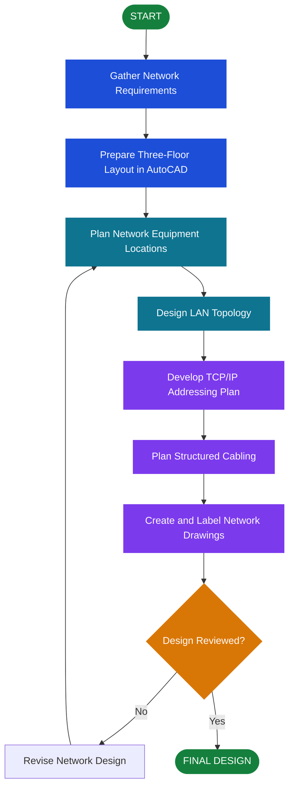

# Building-LAN-Cable-Networking-Plan
LCN plan

# 🖥️ Three-Storey BPO LAN Design
### Network Infrastructure Design

  
  
  

  <strong>Designing a Structured and Organized Network for a Three-Storey BPO Facility</strong>

## 📌 Project Description

The **Three-Storey BPO LAN Design** is a network infrastructure design project focused on planning a Local Area Network (LAN) for a three-storey Business Process Outsourcing (BPO) facility.

The project uses **AutoCAD** to create and organize network layout plans, including the placement of network equipment, workstation connections, network topology, IP addressing plans, and structured cabling routes.

The design aims to provide an organized, reliable, and scalable network infrastructure that supports communication and connectivity across all three floors of the building.

## 🎯 Objectives

- Design a LAN infrastructure for a three-storey BPO facility.
- Plan the placement of workstations and network equipment.
- Develop a network topology connecting all floors.
- Prepare an IP addressing plan using TCP/IP concepts.
- Plan structured cabling routes for network connectivity.
- Use AutoCAD to create clear and organized network layout drawings.

## ✨ Main Components of the Design

- 🖥️ **Workstation Layout** — Planned locations for computers and other network-connected devices.
- 🔀 **Network Topology** — A logical representation of how network devices connect.
- 🌐 **TCP/IP Addressing** — An IP addressing scheme for organizing network devices.
- 🔌 **Structured Cabling** — Planned cable routes and network outlets throughout the building.
- 🗄️ **Network Equipment Placement** — Proposed locations for switches, routers, racks, and related equipment.
- 📐 **AutoCAD Floor Plans** — Technical drawings showing network infrastructure on each floor.

*These are design elements to document according to what your actual drawings contain.*

## 🔄 Project Workflow

1. **Gather Requirements** — Identify the building layout, expected workstations, and network needs.
2. **Prepare Floor Plans** — Organize the three-storey layout in AutoCAD.
3. **Plan Equipment Locations** — Determine suitable locations for network racks, switches, routers, and outlets.
4. **Design the Network Topology** — Plan connections between floors and network devices.
5. **Develop the IP Addressing Plan** — Assign proposed IP subnets and addressing ranges.
6. **Plan Structured Cabling** — Draw cable routes and identify network outlet locations.
7. **Prepare Final Drawings** — Organize the floor plans, labels, legends, and network details.
8. **Review the Design** — Check connectivity, cable routes, equipment placement, and documentation.

## 📊 Project Flowchart

## 🧰 Tools and Technologies

| Tool / Technology | Purpose |
|---|---|
| **AutoCAD** | Creates floor plans, equipment layouts, cable routes, and technical drawings |
| **TCP/IP** | Provides the networking framework for device communication |
| **IP Addressing and Subnetting** | Organizes network devices into appropriate IP networks |
| **Structured Cabling** | Plans physical network connections and cable pathways |
| **LAN Topology** | Represents how network devices and floors are interconnected |

## 🖥️ Application Used

  

**AutoCAD** is the primary design application used for this project. It supports the creation of technical floor plans, network equipment layouts, cable routing drawings, and labeled infrastructure plans.

## 🌐 Networking Concepts

### TCP/IP

TCP/IP is the networking protocol suite used to support communication between devices across interconnected networks. The design uses TCP/IP concepts when planning the logical network structure and IP addressing.

### IP Addressing

The IP addressing plan organizes devices into appropriate network ranges. Depending on the design requirements, separate subnets or VLANs may be planned for different floors, departments, or device categories.

### Structured Cabling

Structured cabling provides an organized physical infrastructure for connecting computers, network outlets, switches, and communication rooms. The drawings can identify cable routes, outlets, cable types, and equipment locations where applicable.

### LAN Topology

The LAN topology describes how the network devices connect. A hierarchical star design may be considered for a multi-floor office, with floor-level access switches connected to a central distribution point, depending on the project's requirements.

## 🚀 Potential Improvements

- Add a detailed IP addressing and subnetting table.
- Include a separate network layout for each floor.
- Add network rack and switch-port documentation.
- Label cable routes and network outlet identifiers.
- Document VLANs and departmental network separation, if applicable.
- Validate cable lengths, capacity, and equipment requirements.
- Include a logical network diagram alongside the physical AutoCAD drawings.

## 👨‍💻 Project Information

- **Project Title:** Three-Storey BPO LAN Design
- **Project Category:** Network Infrastructure
- **Design Application:** AutoCAD
- **Networking Concepts:** TCP/IP, IP Addressing, LAN Topology, Structured Cabling
- **Developer:** [Your Name]
- **Project Year:** [Your Project Year]

---

  <strong>🌐 Connecting Every Floor Through Structured Network Design</strong> 
  <em>Organized infrastructure for a connected workplace.</em>

